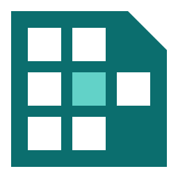
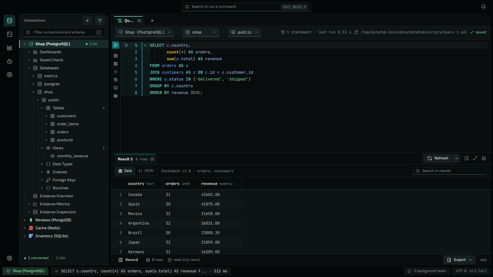
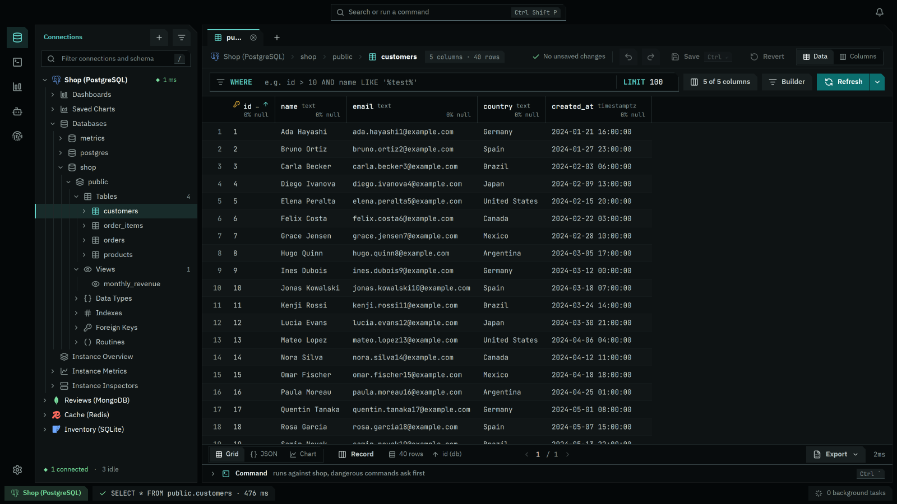
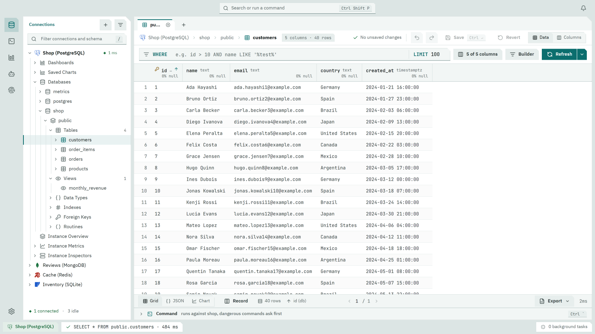

<p align="center">
  
</p>

<h1 align="center">DataTab</h1>

<p align="center">
  One keyboard-first window for the databases you work with.
</p>

<p align="center">
  <a href="https://datatab.pcplab.me">datatab.pcplab.me</a> ·
  <a href="docs/GETTING_STARTED.md">Getting started</a> ·
  <a href="docs/DRIVERS.md">Drivers</a> ·
  <a href="docs/KEYBOARD.md">Keyboard</a>
</p>



| Dark | Light |
| --- | --- |
|  |  |

> These images show DataTab running with sample data.

## What it is

DataTab is a native desktop database client for Linux and Windows, with an experimental macOS build, written in Rust with GPUI. Tables, documents, keys, logs and objects all open in tabs, and you can reach every action from the keyboard.

- **Keyboard first.** Move with `j`, `k`, `h` and `l`, run anything from the command palette with `Ctrl+Shift+P`, and keep your hands on the keys.
- **Many databases, one workspace.** The interface adapts through driver metadata and has no special case for a driver.
- **Yours alone.** DataTab talks only to the servers you configure. It has no telemetry, no crash reporter, no update check and no account. See the [Privacy Policy](PRIVACY.md).
- **A record of what ran.** An audit log on your machine covers queries, connections, hooks, scripts and AI tool calls. It redacts by default, and you can turn it off.

**Status: early release.** Installers for Linux (`.deb`) and Windows, and an experimental `DataTab.app` for macOS on Intel and Apple Silicon, are on the [releases page](https://github.com/patcharp/datatab/releases) once published. You can also [build it from source](#build-from-source).

## Databases

| Kind | Supported |
| --- | --- |
| Relational | PostgreSQL, MySQL and MariaDB, SQLite, Microsoft SQL Server, Amazon Redshift, ClickHouse, TursoDB and libSQL, DuckDB |
| Document and key-value | MongoDB, Redis, DynamoDB |
| Time series and logs | InfluxDB v1 and v2, CloudWatch Logs |
| Object storage | Amazon S3 and S3-compatible endpoints |
| Secrets | AWS Secrets Manager and Parameter Store |
| Anything else | External drivers over the [Driver RPC Protocol](docs/DRIVER_RPC_PROTOCOL.md) |

[Drivers Overview](docs/DRIVERS.md) has the full capability matrix and each driver's limits.

## Features

**Workspace**

- Tabs for queries, tables, documents, charts and dashboards. With session restore on, saved query tabs come back when you reopen the app
- A schema tree that loads lazily, with indexes, foreign keys, constraints and routines
- A SQL editor with syntax highlighting and one result set per statement
- A virtualized data grid with sorting, filters, pagination and inline editing
- Copy a row as SQL, a MongoDB shell command or a Redis command

**Visual query builder**

- Compose SELECT, UPDATE and DELETE without writing SQL, with a live preview
- Joins, nested conditions, GROUP BY and HAVING, and saved queries for each connection
- A guard on UPDATE and DELETE with no WHERE, plus read-only and approval policies, and chunked, cancellable execution

**Charts and dashboards**

- Chart any result: line, bar, scatter, area, stacked bar and pie
- Dashboards on a 12-column grid with a shared time range
- A read-only instance overview with live server metrics

**Connecting**

- SSH tunnels, SOCKS5 and HTTP proxies, and AWS SSM, with reusable profiles
- AWS SSO, shared and static auth profiles
- Hooks before and after connecting, as a command, a script or Lua

**AI through MCP, under your control**

- A built-in Model Context Protocol server: `datatab mcp`
- Each operation is classified, checked against your roles and policies, and can wait for your approval

**Scripts and export**

- Lua, Python and Bash scripts run as documents with live output
- Export to CSV, JSON, text or binary, by result type

## Documentation

| I want to | Read |
| --- | --- |
| Make my first connection | [Getting Started](docs/GETTING_STARTED.md) |
| Set up tunnels, proxies or AWS | [Connecting](docs/CONNECTIONS.md) |
| Run queries and work with results | [Usage](docs/USAGE.md) |
| Learn the keys | [Keyboard](docs/KEYBOARD.md) |
| Build charts and dashboards | [Charts](docs/CHARTS.md), [Dashboards](docs/DASHBOARDS.md) |
| Use an AI client | [AI and MCP](docs/MCP_AI_INTEGRATION.md) |
| Review what ran | [Audit](docs/AUDIT.md) |
| Change settings or add hooks | [Settings](docs/SETTINGS.md), [Lua](docs/LUA.md) |

## Build from source

Install the Rust toolchain with [rustup](https://rustup.rs). `rust-toolchain.toml` picks the version. Then, from the root of the checkout:

```bash
sh scripts/build-linux.sh --deb                                     # Linux: binary and .deb
powershell -ExecutionPolicy Bypass -File scripts\build-windows.ps1   # Windows: datatab.exe and installer
```

[Building from source](docs/BUILDING.md) lists the prerequisites, options and fixes for common failures. A full release build peaked at about 8 GB of RAM with 2 build jobs. macOS is experimental: the guide covers `scripts/build-macos.sh`.

## Contributing

- [CONTRIBUTING.md](CONTRIBUTING.md): how to report a problem or contribute
- [ARCHITECTURE.md](ARCHITECTURE.md): crate map and boundaries
- [Key Concepts](docs/CONCEPTS.md) and [Driver Authoring](docs/DRIVER_AUTHORING.md): add a driver
- [Code Style](CODE_STYLE.md): code rules

The website, [datatab.pcplab.me](https://datatab.pcplab.me), is built from a separate repository. It publishes the guides under `docs/`.

## Publisher and contact

DataTab is published by PCPLab. Report a bug or a security problem to [me@pcplab.me](mailto:me@pcplab.me). See [SECURITY.md](SECURITY.md).

## License

MIT or Apache-2.0, at your option: [LICENSE-MIT](LICENSE-MIT), [LICENSE-APACHE](LICENSE-APACHE).

Derived from DBFlux. Not the official DBFlux. [UPSTREAM.md](UPSTREAM.md) records the origin, and [TRADEMARK.md](TRADEMARK.md) covers the upstream name and logo.
